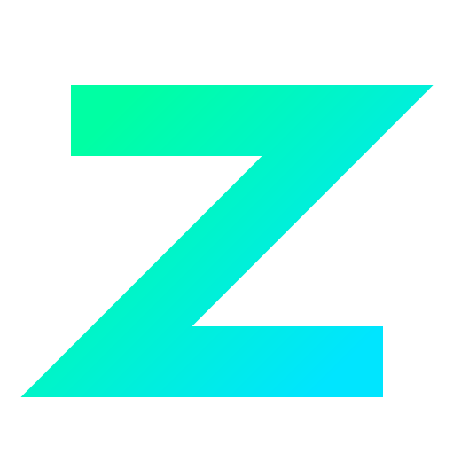

<div align="center">
  
    <h1>zkzzk (Chzzk Video Manager)</h1>
    <p><strong>치지직 자동 녹화 및 VOD 관리를 위한 완벽한 솔루션</strong></p>

  <p>
    <a href="https://github.com/k-atusa/zkzzk/releases"></a> 
    <a href="https://github.com/k-atusa/zkzzk/blob/main/LICENSE"></a> 
    <a href="https://hub.docker.com/r/d3vle0/zkzzk"></a> 
    <a href="https://github.com/k-atusa/zkzzk/stargazers"></a> 
  </p>

  <p>
    <a href="README.md">🇺🇸 English</a> | <a href="README-ko.md">🇰🇷 한국어</a>
  </p>
</div>

## 🤔 zkzzk 이란?

**zkzzk**는 [네이버 치지직(Chzzk)](https://chzzk.naver.com) 방송을 자동으로 녹화하고 VOD를 손쉽게 다운로드 및 관리할 수 있도록 설계된 강력한 오픈소스 웹 애플리케이션입니다. 여러분이 좋아하는 스트리머의 영상을 편리하게 아카이빙할 수 있습니다.

<br>

## ✨ 주요 기능

- **🔴 라이브 자동 녹화**: 좋아하는 스트리머를 추가해 두면, 방송이 시작될 때 zkzzk가 자동으로 실시간 녹화를 진행합니다.
- **📼 VOD 다운로더**: 지나간 VOD를 검색하고 원하는 해상도로 쉽게 다운로드할 수 있습니다.
- **📺 유튜브 자동 업로드**: 구글 계정과 연동하여, 녹화가 완료된 영상을 자동 업로드할 수 있습니다.
- **🔔 디스코드 알림**: 방송 시작, 종료, 업로드 완료 등의 상태를 디스코드 웹훅(Rich-card 형태)으로 실시간 알림을 받을 수 있습니다.
- **🛡️ 안전한 관리자 대시보드**: 다중 사용자 지원, 관리자 권한 및 2FA(이중 인증)를 지원하여 안전하게 시스템을 관리할 수 있습니다.
- **🌐 다국어 지원**: 한국어와 영어를 모두 기본적으로 완벽하게 지원합니다.

<br>

## 🚀 빠른 시작

Docker로 `FFmpeg`와 `Streamlink`를 포함한 zkzzk를 바로 실행할 수 있습니다:

```bash
docker run -d \
  --name zkzzk-app \
  --restart unless-stopped \
  -p 5001:5001 \
  -e TZ=Asia/Seoul \
  -v $(pwd)/data:/app/backend \
  -v $(pwd)/downloads:/app/downloads \
  d3vle0/zkzzk:latest
```

실행 후 브라우저에서 `http://localhost:5001`에 접속하세요.  
**Docker Compose**, **단일 바이너리 실행**(Windows / Linux / macOS), **소스 빌드** 방법은 아래 문서를 참고해 주세요.

<br>

## 📚 문서 및 설치 가이드

자세한 설치, 환경 설정, 그리고 보안 설정 방법은 **[공식 문서](./docs/kr/Home.md)**를 참고해 주세요.

문서 포함 내용:
- 🐳 **[Docker Setup](./docs/kr/Docker-Setup.md)** (권장)
- 💻 **[Manual Setup](./docs/kr/Manual-Setup.md)** (단일 바이너리 / 소스 빌드)
- 🔒 **[Reverse Proxy Configuration](./docs/kr/Reverse-Proxy-Configuration.md)** (Nginx / Nginx Proxy Manager)
- 🔑 **[설정 및 YouTube API 연동 가이드](./docs/kr/Settings-Guide.md)**

<br>

## 🛠️ 기술 스택

- **Frontend**: React, TypeScript, Vite, TailwindCSS, Shadcn UI
- **Backend**: Go (프론트엔드 내장 단일 바이너리), SQLite
- **Core Dependencies**: FFmpeg, Streamlink

<br>

## 🤝 기여하기 (Contributing)

오픈소스 커뮤니티는 여러분의 기여를 통해 더욱 발전합니다. 어떠한 형태의 기여든 **진심으로 환영합니다**.

자세한 기여 가이드라인은 [CONTRIBUTING.md](CONTRIBUTING.md) 파일을 확인해 주세요.

## 📄 라이선스

MIT 라이선스 하에 배포됩니다. 자세한 내용은 `LICENSE` 파일을 참조하세요.
